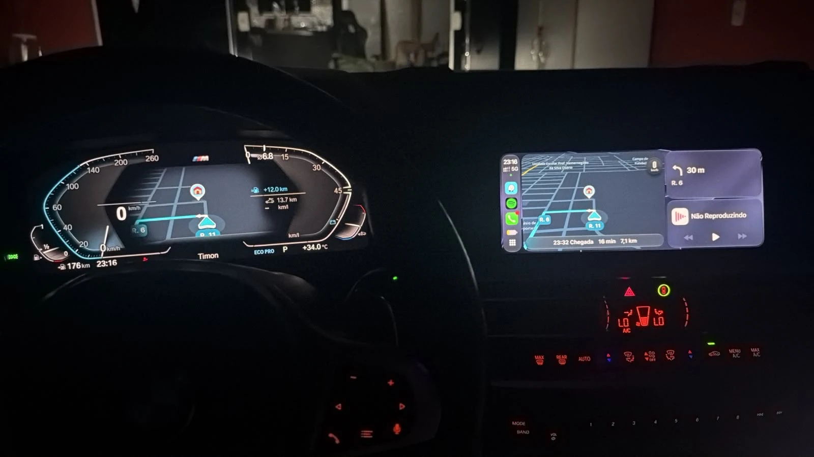

# CarPlay map → instrument cluster (Store-ready)

Mirrors the **CarPlay Dashboard map** onto the BMW **iDrive 7 / MGU** instrument cluster **without** patching `/usr/bin/carplay`.

| | |
|---|---|
| Tool | `carplay-map` **0.2.10** |
| Toggle app | `carplay_map_toggle` **0.1.1** (“Map on cluster”) |
| Catalog | `mgu-repo.json` (MGU Store **Add source** works) |
| Repo | [Brusk-eng/carplay-map-cluster](https://github.com/Brusk-eng/carplay-map-cluster) |



*Mirror of CarPlay’s map on the cluster (left) while Dashboard stays on the center screen (right).*

> This is a **screen copy**, not a second CarPlay video stream. It will not feel like patched CarPlay 21/22.

---

## Why this exists

Some older CarPlay builds cannot be patched for a real cluster stream (`patchable: no`). This tool is a workaround: capture the center screen and paint the map into **`cluster-render`**.

It ships with `mgu-repo.json` so MGU Store **Add source** works.

---

## What it is (and isn’t)

**`waze-on-cluster`** (robertn / idrive-apps) patches CarPlay so the phone opens an **alternate-display** stream to the cluster. That needs a patchable CarPlay build (proven **21.27.4** / **22.28.3**). On older builds (e.g. **20.40.2**) probe says `patchable: no`.

**This tool** instead:

1. Captures the **center** screen with stock `winston-grabber`
2. Crops the map region
3. Pushes frames into **`cluster-render`** (~3–6 fps)

| | This tool (`carplay-map`) | `waze-on-cluster` |
|---|---|---|
| Touches `/usr/bin/carplay` | No | Yes |
| Needs patchable CarPlay | No | Yes |
| Quality | Mirror / low fps | Native 2nd stream |
| Layout | **Dashboard only** | Full cluster map path |
| Same map slot | Yes — **do not install both** | Yes |

---

## Conflict with `waze-on-cluster`

These are **different** products that fight the same cluster map slot.

This tool **blocks** if `/var/opt/waze-on-cluster/current` exists:

- SSH `install/install.sh`
- Store **activate** (`check-conflict.js` → install rolls back)
- Runtime (producer exits)

**Uninstall `waze-on-cluster` first**, then install this.

---

## Prerequisites

1. Rooted iDrive 7 **MGU** + working **MGU Store**
2. **`cluster-render`** installed (does the hard cluster drawing)
3. **`app-privacy`** — required for the on/off app only
4. Stock HU tools: `node`, `winston-grabber`, Wayland (`wayland-0`)
5. Car internet (or phone hotspot) for Store GitHub sources

---

## Install via MGU Store (preferred)

1. Uninstall **waze-on-cluster** (and its Maps-on-cluster app) if present  
2. Store → Settings → **+ Add source** → `Brusk-eng/carplay-map-cluster` → branch **main**  
3. Install **cluster-render** (if missing) and **app-privacy**  
4. Install **CarPlay map → cluster** (`carplay-map` **0.2.10**)  
5. Install **Map on cluster** (`carplay_map_toggle`)  
6. Connect iPhone CarPlay → open a map in **Dashboard** layout (map left + cards right)  
7. Look at the instrument cluster  

---

## Install via SSH (optional)

```sh
# on the unit, as root, repo root:
chmod +x install/install.sh
./install/install.sh
# optional: ./install/install.sh /path/to/cluster_render_client.js
```

The script refuses if `waze-on-cluster` is current, packs the tool with correct file hashes, installs via `mgu-deploy`, then tries the toggle app.

---

## Using it

- CarPlay must stay **visible** (BMW menu in front → nothing to capture → blank)  
- Use **Dashboard** map layout (fullscreen map is gated off on purpose)
- **No-route “me” puck:** default crop matches cluster aspect + bilinear scale so the free-drive cursor is less likely to vanish (route-on was already fine)
- **Hold last map** (default): leave Dashboard (e.g. Spotify) → cluster keeps a **frozen** last map until Dashboard returns; toggle Off clears it  
- Toggle with **Map on cluster**; service auto-starts on boot (`--gate-initial menu`)  
- If crop/detection looks wrong on your CarPlay build, calibrate on the unit:

```sh
WAYLAND_DISPLAY=wayland-0 XDG_RUNTIME_DIR=/run/wayland \
  node /var/opt/carplay-map/current/carplay-map-cluster.js --calibrate --verbose
```

---

## Repo layout

```
mgu-repo.json                 Store catalog
native/carplay-map/           tool (producer + systemd + activate conflict check)
app/carplay_map_toggle/       on/off OAP app (build: unit)
install/install.sh            SSH installer
producer/                     same producer script (legacy / quick test)
packages/carplay-map-tool/    legacy package metadata for install.sh
docs/demo.webp                demo image
```

---

## Credits & license

- Cluster drawing: **robertn** [`cluster-render`](https://github.com/robertnisipeanu/idrive-apps) / [MGU Store](https://github.com/robertnisipeanu/mgu-store) (GPL — client loaded from the installed package, not vendored here)
- This repo: [Brusk-eng/carplay-map-cluster](https://github.com/Brusk-eng/carplay-map-cluster)

Producer / packaging: **MPL-2.0**. Toggle app: see headers / [LICENSE](LICENSE).
